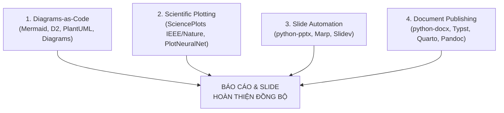

# Academic Report, Diagrams & Slide Generator Skill

This skill transforms Antigravity into an **Autonomous Academic Publishing & Visualization Engine**. It allows generating publication-grade figures, diagrams-as-code, university thesis reports (`.docx`), and presentation slide decks (`.pptx`) automatically without manual formatting.

---

## 4 PILLARS OF ACADEMIC VISUALIZATION & PUBLISHING



---

## 1. DIAGRAMS-AS-CODE (SƠ ĐỒ THUẬT TOÁN, KIẾN TRÚC & GANTT)

* **[Mermaid.js](https://github.com/mermaid-js/mermaid):** Flowchart, Sequence, Class, ERD, and Gantt charts.
  * Render command: `python scripts/render_mermaid.py "flowchart TD ..."` or `npx -p @mermaid-js/mermaid-cli mmdc -i diagram.mmd -o diagram.png -s 3`.
* **[Diagrams (Python)](https://github.com/mingrammer/diagrams):** Python code generating cloud system architecture with vendor icons (AWS, GCP, Docker, Postgres).
* **[D2](https://github.com/terrastruct/d2):** Modern software architecture diagrams with automatic clean layout.
* **[PlantUML](https://github.com/plantuml/plantuml):** Formal UML standard diagrams (Use Case, Activity, Sequence) for Software Engineering theses.
* **[Excalidraw](https://github.com/excalidraw/excalidraw):** Hand-drawn style sketches for conceptual presentation slides.
* Reference details: [references/diagrams_as_code.md](./references/diagrams_as_code.md)

---

## 2. SCIENTIFIC DATA VISUALIZATION (BIỂU ĐỒ CHUẨN IEEE / NATURE)

* **[SciencePlots](https://github.com/garrettj403/SciencePlots):** Applies publication styling to Matplotlib with one line:
  ```python
  import matplotlib.pyplot as plt
  import scienceplots
  plt.style.use(['science', 'no-latex', 'grid'])
  ```
  * Script helper: `python scripts/make_ieee_plot.py --output my_figure.png`
* **[PlotNeuralNet](https://github.com/HarisIqbal88/PlotNeuralNet):** 3D layered neural network architectures in TikZ/LaTeX.
* **[Apache ECharts](https://github.com/apache/echarts):** Radar charts, Sankey diagrams, Sunburst charts for multi-metric comparison.
* Reference details: [references/scientific_plotting.md](./references/scientific_plotting.md)

---

## 3. PRESENTATION & SLIDE AUTOMATION (16:9 WIDESCREEN)

* **[python-pptx](https://github.com/scanny/python-pptx):** Generates native, fully editable `.pptx` presentations with precise control over layout, brand colors, tables, and typography.
  * Script helper: `python scripts/build_deck_pptx.py --output My_Presentation.pptx`
* **[Marp](https://github.com/marp-team/marp):** Markdown to PowerPoint/PDF:
  * Command: `npx @marp-team/marp-cli slides.md -o presentation.pptx`
* **[Slidev](https://github.com/slidevjs/slidev):** Interactive technical presentations with Shiki code highlighting and live components.
* Reference details: [references/slide_automation.md](./references/slide_automation.md)

---

## 4. MULTI-FORMAT ACADEMIC PUBLISHING (WORD / TYPST / QUARTO)

* **[python-docx](https://github.com/python-openxml/python-docx):** Generates standardized university thesis and project reports matching margin (2.5cm), font (Times New Roman), and table captioning rules.
  * Script helper: `python scripts/build_academic_doc.py --output My_Report.docx`
* **[Typst](https://github.com/typst/typst):** Instant compilation (<30ms) alternative to LaTeX for mathematical papers and university theses.
* **[Quarto](https://github.com/quarto-dev/quarto-cli):** Single Markdown file exporting to Word, PDF, and Slides simultaneously.
* **[Pandoc](https://github.com/jgm/pandoc):** Cross-format document converter with custom `--reference-doc`.
* Reference details: [references/academic_publishing.md](./references/academic_publishing.md)

---

## INCLUDED HELPER SCRIPTS

* [`scripts/make_ieee_plot.py`](./scripts/make_ieee_plot.py): Generates IEEE/Nature standard 300 DPI figures.
* [`scripts/build_academic_doc.py`](./scripts/build_academic_doc.py): Generates standardized academic Word reports with cover page, TOC structure, and styled tables.
* [`scripts/build_deck_pptx.py`](./scripts/build_deck_pptx.py): Generates 16:9 widescreen PowerPoint presentation decks.
* [`scripts/render_mermaid.py`](./scripts/render_mermaid.py): Compiles Mermaid diagram syntax into high-resolution PNG/SVG images.
