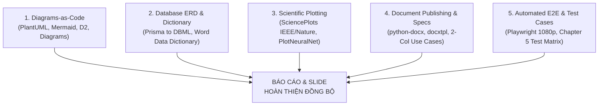

# Universal Academic Publishing & Software Engineering Thesis Generator

This skill transforms Antigravity into an **Autonomous Universal Academic Publishing & Software Engineering Engine**. It allows generating publication-grade figures, diagrams-as-code, ERD & data dictionaries, standardized thesis reports (`.docx`), 2-column Use Case specs, and presentation slide decks (`.pptx`) automatically for **any software project or graduation thesis**.

---

## 5 PILLARS OF ACADEMIC & SOFTWARE ENGINEERING AUTOMATION



---

## 1. DIAGRAMS-AS-CODE (UML, FLOWCHART & SYSTEM ARCHITECTURE)

* **[PlantUML](https://github.com/plantuml/plantuml):** Standard UML 2.0 for computer science theses (Use Case, Sequence with `alt/else`, Activity with Swimlanes).
  * Helper script: `python scripts/generate_uml_templates.py --output-dir ./uml_output`
* **[Mermaid.js](https://github.com/mermaid-js/mermaid):** Flowcharts, State diagrams, Sequence diagrams, and Gantt charts.
  * Render helper: `python scripts/render_mermaid.py "flowchart TD ..."` or `npx -p @mermaid-js/mermaid-cli mmdc -i diagram.mmd -o diagram.png -w 2400 -b white`.
* **[Diagrams (Python)](https://github.com/mingrammer/diagrams):** Python code generating cloud system architectures with official vendor icons (AWS, Azure, GCP, Docker, Next.js, Postgres, Redis, SQL Server).
* **[D2](https://github.com/terrastruct/d2):** Modern software architecture diagrams with auto-layout Dagre/ELK engines.
* Reference details: [references/uml_diagrams_as_code.md](./references/uml_diagrams_as_code.md) & [references/architecture_and_cloud_diagrams.md](./references/architecture_and_cloud_diagrams.md)

---

## 2. DATABASE ERD & DATA DICTIONARY AUTOMATION

* **Prisma to Word Data Dictionary:**
  * Script helper: `python scripts/export_prisma_data_dictionary.py --schema <path_to_schema.prisma> --output-docx Tu_Dien_CSDL.docx`
  * Automatically scans models, fields, native SQL types, PK/FK, Nullable, and constraints to produce an academic Word table and Markdown documentation.
* **Prisma to DBML (dbdiagram.io & chartdb.io):**
  * Script helper: `python scripts/export_prisma_dbml.py --schema <path_to_schema.prisma> --output schema.dbml`
  * Converts any schema to DBML with relationships (`Ref: A.id > B.id`) ready for 4K PNG export.
* Reference details: [references/database_erd_and_dictionary.md](./references/database_erd_and_dictionary.md)

---

## 3. SCIENTIFIC DATA VISUALIZATION (IEEE / NATURE)

* **[SciencePlots](https://github.com/garrettj403/SciencePlots):** Publication styling for Matplotlib:
  ```python
  import matplotlib.pyplot as plt
  import scienceplots
  plt.style.use(['science', 'no-latex', 'grid'])
  ```
  * Script helper: `python scripts/make_ieee_plot.py --output my_figure.png`
* **[PlotNeuralNet](https://github.com/HarisIqbal88/PlotNeuralNet):** 3D layered neural network architectures in TikZ/LaTeX.
* Reference details: [references/scientific_plotting.md](./references/scientific_plotting.md)

---

## 4. DOCUMENT PUBLISHING, USE CASE SPECS & SLIDES

### QUY TẮC BẮT BUỘC KHI XUẤT BẢN SLIDE VÀ BÁO CÁO:
1. **Tỷ lệ Slide chuẩn 16:9 Widescreen:** Mọi file PowerPoint `.pptx` BẮT BUỘC phải thiết lập rõ ràng tỷ lệ 16:9 (`prs.slide_width = Inches(13.333)`, `prs.slide_height = Inches(7.5)`). Tuyệt đối không để kích thước mặc định 4:3 (10x7.5 in).
2. **Cấu trúc Báo cáo Word chuẩn mực:** Báo cáo Word `.docx` BẮT BUỘC phải có Mục lục tự động, Danh mục bảng biểu/hình ảnh và Danh mục tài liệu tham khảo (References).
3. **Đồng bộ Nguồn Chân Lý Duy Nhất (Single Source of Truth):** Tuyệt đối không hardcode số liệu ước lượng. Mọi chỉ số (Accuracy, F1, Ma trận nhầm lẫn, Top đặc trưng, số lượng mẫu) trong Slide và Báo cáo Word BẮT BUỘC phải đối chiếu chéo (cross-check) khớp 100% với output thực tế của mã nguồn/notebook.

* **[python-docx](https://github.com/python-openxml/python-docx):** Generates thesis reports matching standard margins (2.5cm), Times New Roman font, and numbered table captions.
  * Report helper: `python scripts/build_academic_doc.py --output BaoCao_Chuan.docx`
* **Universal 2-Column Use Case Specification:**
  * Script helper: `python scripts/generate_use_case_specs_doc.py --output-docx Dac_Ta_Use_Case.docx`
  * Formatted with Table 3.X captions, Actor | System action-response flows, and exception flows.
* **[python-pptx](https://github.com/scanny/python-pptx):** Editable 16:9 widescreen presentation slide decks:
  * Slide helper: `python scripts/build_deck_pptx.py --output Slide_Thuyet_Trinh.pptx`
* Reference details: [references/word_docx_and_specs_automation.md](./references/word_docx_and_specs_automation.md) & [references/slide_automation.md](./references/slide_automation.md)

---

## 5. AUTOMATED SCREENSHOTS & CHAPTER 5 TEST CASES

* **[Playwright](https://github.com/microsoft/playwright):** Automated batch screenshot capture at 1920x1080 (16:9):
  * Script helper: `node scripts/capture_playwright_screens.mjs --base-url http://localhost:3000 --output ./screenshots`
  * Generates clean images named `Hinh_4_01_...png` and Markdown figure catalog.
* **Universal Chapter 5 Test Cases Matrix:**
  * Script helper: `python scripts/generate_testcases_doc.py --output-docx Bang_Kiem_Thu_He_Thong.docx`
  * Generates 7-column test cases table with green `PASS` / red `FAIL` highlights.
* Reference details: [references/playwright_e2e_and_testcases.md](./references/playwright_e2e_and_testcases.md)

---

## INCLUDED UNIVERSAL HELPER SCRIPTS

| Script | Purpose & Capabilities |
|---|---|
| [`scripts/export_prisma_data_dictionary.py`](./scripts/export_prisma_data_dictionary.py) | Reads any `schema.prisma` -> Exports Word `.docx` & Markdown Data Dictionary. |
| [`scripts/export_prisma_dbml.py`](./scripts/export_prisma_dbml.py) | Reads any `schema.prisma` -> Exports `.dbml` for dbdiagram.io / chartdb. |
| [`scripts/generate_use_case_specs_doc.py`](./scripts/generate_use_case_specs_doc.py) | Generates academic 2-column Use Case specification tables in Word. |
| [`scripts/generate_testcases_doc.py`](./scripts/generate_testcases_doc.py) | Generates Chapter 5 software test cases table with Pass/Fail highlighting. |
| [`scripts/generate_uml_templates.py`](./scripts/generate_uml_templates.py) | Generates standard PlantUML & Mermaid templates (Sequence, Activity, Use Case). |
| [`scripts/capture_playwright_screens.mjs`](./scripts/capture_playwright_screens.mjs) | Batch captures 1920x1080 screenshots of routes using Playwright. |
| [`scripts/make_ieee_plot.py`](./scripts/make_ieee_plot.py) | Generates IEEE/Nature 300 DPI figures and PDF vector plots. |
| [`scripts/build_academic_doc.py`](./scripts/build_academic_doc.py) | Generates complete academic thesis report structure in Word. |
| [`scripts/build_deck_pptx.py`](./scripts/build_deck_pptx.py) | Generates 16:9 widescreen PowerPoint presentation decks. |
| [`scripts/render_mermaid.py`](./scripts/render_mermaid.py) | Compiles Mermaid syntax to high-res PNG/SVG images. |
