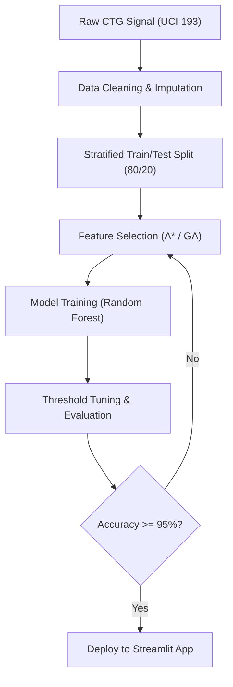
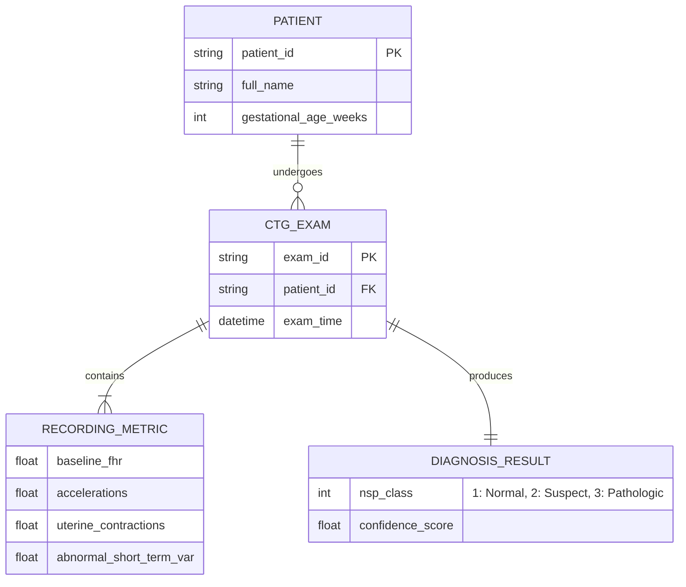
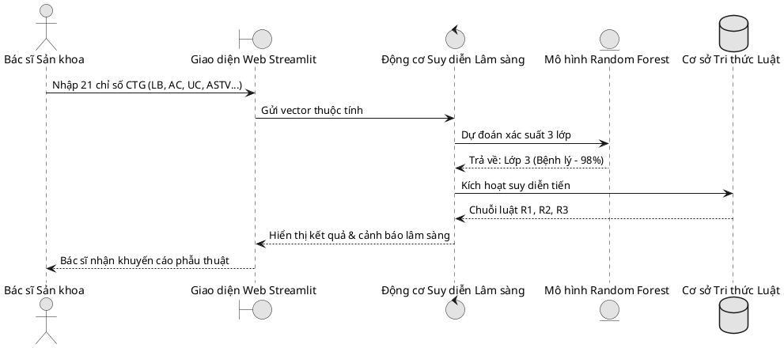

# Diagrams-as-Code Reference Manual

This guide covers programmatic diagramming tools to produce crisp system architectures, flowcharts, ERDs, and Gantt charts for academic reports, software specifications, and presentation slides.

---

## 1. Mermaid.js (Text-to-Diagram Standard)

* **Repository:** [mermaid-js/mermaid](https://github.com/mermaid-js/mermaid)
* **CLI Tool:** `@mermaid-js/mermaid-cli` (`mmdc`)
* **Best For:** Fast flowcharts, sequence diagrams, state machines, entity-relationship models (ERD), and Gantt charts directly embedded in Markdown.

### CLI Rendering to PNG/SVG:
Using the pre-installed Node.js / npx:
```bash
# Render to high-DPI PNG
npx -p @mermaid-js/mermaid-cli mmdc -i diagram.mmd -o diagram.png -b transparent -s 3

# Render to scalable vector SVG
npx -p @mermaid-js/mermaid-cli mmdc -i diagram.mmd -o diagram.svg
```

### Common Templates:

#### A. System Flowchart with Styling:


#### B. Entity-Relationship Diagram (ERD):


#### C. Academic Project Gantt Chart:
```mermaid
gantt
    title Kế hoạch Triển khai Đồ án Cuối kỳ (2 Tuần)
    dateFormat  YYYY-MM-DD
    section Giai đoạn 1: Chuẩn bị
    Chọn đề tài & nộp đề cương viết tay :done, d1, 2026-11-09, 2d
    Khám phá dữ liệu & Tiền xử lý       :done, d2, after d1, 3d
    section Giai đoạn 2: Thuật toán
    Cài đặt Hệ chuyên gia & A* Search   :active, d3, 2026-11-13, 3d
    Kiểm tra tính tay MLP tại lớp (Ngày 7):crit, d4, 2026-11-15, 1d
    Tối ưu hóa GA & Huấn luyện Model   :d5, after d4, 3d
    section Giai đoạn 3: Báo cáo & Nộp
    Viết báo cáo Word & Soạn Slide PPTX :d6, 2026-11-19, 3d
    Nộp toàn bộ hồ sơ (trước 23:59 22/11):crit, d7, 2026-11-22, 1d
    Vấn đáp & Sửa code phòng lab        :d8, 2026-11-23, 2d
```

---

## 2. Diagrams (mingrammer/diagrams) — Python System Architectures

* **Repository:** [mingrammer/diagrams](https://github.com/mingrammer/diagrams)
* **Requirements:** `pip install diagrams` + Graphviz installed.
* **Best For:** Cloud architectures, microservices, pipeline deployments with official vendor icons (AWS, GCP, Azure, K8s, On-prem).

```python
from diagrams import Diagram, Cluster
from diagrams.programming.language import Python
from diagrams.onprem.database import PostgreSQL
from diagrams.onprem.client import Users
from diagrams.custom import Custom

with Diagram("CTG Clinical Decision Support Architecture", show=False, filename="ctg_architecture"):
    clinicians = Users("Obstetricians / Doctors")
    with Cluster("Application Tier"):
        streamlit_app = Python("Streamlit Web UI\n(app.py)")
        expert_system = Python("Rule-based Engine\n(10 IF-THEN Rules)")
    with Cluster("ML Inference Engine"):
        best_pipeline = Python("Random Forest Pipeline\n(BestModel.joblib)")
        scaler = Python("StandardScaler\nColumnTransformer")
    
    clinicians >> streamlit_app
    streamlit_app >> scaler >> best_pipeline
    streamlit_app >> expert_system
```

---

## 3. D2 (Modern Software Architecture Diagrams)

* **Repository:** [terrastruct/d2](https://github.com/terrastruct/d2)
* **Best For:** Modern software architectures with automatic clean layout (TALA / ELK engines), nested containers, and high aesthetics.

```d2
direction: right

data_source: UCI Repository {
  shape: cylinder
  tooltip: "Cardiotocography ID 193"
}

preprocessing: Data Preprocessing {
  imputer: SimpleImputer (Median)
  scaler: StandardScaler
  imputer -> scaler
}

models: Multi-Model Evaluation {
  rf: Random Forest (Best: 95.04%)
  mlp: Neural Network (MLP)
  rules: Expert System (10 Rules)
}

data_source -> preprocessing.imputer
preprocessing.scaler -> models.rf
preprocessing.scaler -> models.mlp
preprocessing.scaler -> models.rules
```

---

## 4. PlantUML (Academic Software Engineering UML Standard)

* **Repository:** [plantuml/plantuml](https://github.com/plantuml/plantuml)
* **Best For:** Strict UML compliance required by university curricula (Use Case diagrams, Activity diagrams, Class diagrams, Sequence diagrams).



---

## 5. Excalidraw (Hand-Drawn System Visuals)

* **Repository:** [excalidraw/excalidraw](https://github.com/excalidraw/excalidraw)
* **Best For:** Sketch-style diagrams on presentation slides that look approachable, human, and modern without looking like rigid corporate flowcharts.
