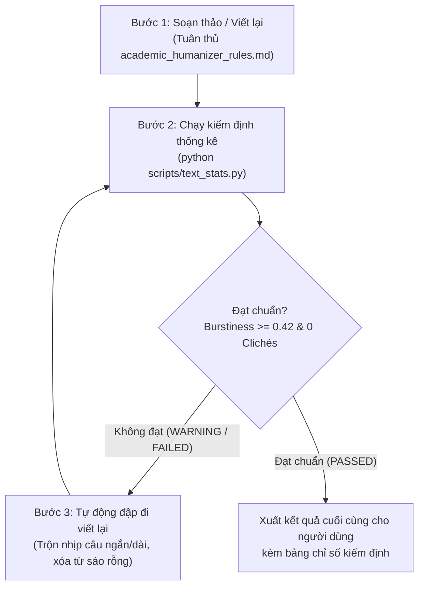

# Academic Writing & Anti-AI Detection Humanizer Skill

This skill transforms Antigravity into an **Authentic Academic Writing & Humanizer Assistant**. It ensures all generated or revised academic texts (theses, essays, lab reports in Vietnamese and English) exhibit genuine human intellectual rhythm, avoiding the statistical signatures that trigger Turnitin AI Detection, GPTZero, CopyLeaks, and Desklib DeBERTa.

---

## 3-STEP CLOSED-LOOP WORKFLOW (BẮT BUỘC THỰC HIỆN KHI VIẾT/SỬA BÀI)

Mỗi khi người dùng yêu cầu viết một đoạn văn, bài tiểu luận, báo cáo hoặc chuốt lại văn bản học thuật, agent **bắt buộc tuân thủ quy trình khép kín 3 bước**:



---

### BƯỚC 1: SOẠN THẢO VÀ CHUỐT VĂN PHONG (DRAFTING & REWRITING)

Tuân thủ nghiêm ngặt cẩm nang [references/academic_humanizer_rules.md](./references/academic_humanizer_rules.md):

1. **Cấm tuyệt đối từ vựng và cấu trúc rập khuôn (Red Flags):**
   * **Tiếng Việt:** Tuyệt đối không mở đầu bằng *"Trong bối cảnh hiện nay..."*, *"Không thể phủ nhận rằng..."*, *"Như chúng ta đã biết..."*, *"Tóm lại, việc..."*; không lặp đi lặp lại *"Đóng vai trò vô cùng quan trọng / then chốt..."*.
   * **Tiếng Anh:** Tuyệt đối không dùng *delve, tapestry, testament, underscore, pivotal, intricate, crucial, foster, harness, embark, beacon, realm, furthermore, moreover, "a double-edged sword"*.
2. **Kỹ thuật trộn nhịp câu 3 tầng (3-Tier Burstiness Injection):**
   * *Tầng 1 (Ngắn gọn, dứt khoát: 4–9 từ):* Dùng chốt luận điểm hoặc gây chú ý.
   * *Tầng 2 (Câu phức phân tích sâu: 28–42 từ):* Sử dụng mệnh đề phụ, quan hệ nhân quả, dấu chấm phẩy (`;`).
   * *Tầng 3 (Câu vừa phải: 12–18 từ):* Trình bày phương pháp hoặc kết quả.
   * *Quy tắc:* Không bao giờ viết 3 câu liên tiếp có độ dài xấp xỉ nhau.
3. **Tính cụ thể hóa (Empirical Grounding):** Luôn gắn liền với số liệu cụ thể, tên phương pháp thực tế, hoặc bối cảnh thử nghiệm thay vì các nhận định chung chung.

---

### BƯỚC 2: KIỂM ĐỊNH TỰ ĐỘNG BẰNG CÔNG CỤ (AUDITING)

Chạy trực tiếp công cụ đo lường chữ ký ngôn ngữ có sẵn trong skill:

```bash
python scripts/text_stats.py "Đoạn văn vừa viết..."
```

**Tiêu chuẩn an toàn cần đạt:**
* **Trạng thái:** `PASSED`
* **Burstiness Index:** $\ge 0.42$ (Đảm bảo độ biến thiên chiều dài câu đủ lớn để phá vỡ dự đoán của mô hình xác suất).
* **Type-Token Ratio (TTR):** $\ge 0.42$ (Độ phong phú từ vựng).
* **Detected Clichés:** `0` (Không chứa bất kỳ cụm từ nhận diện AI nào).
* *(Tùy chọn với bài Tiếng Anh):* Chạy `python scripts/detect_hf_api.py "..."` để kiểm tra độ nhạy với mô hình DeBERTa-v3 của Desklib.

---

### BƯỚC 3: TỰ ĐỘNG CHỈNH SỬA VÀ HOÀN TẤT (SELF-CORRECTION LOOP)

* Nếu kết quả trả về `WARNING` hoặc `FAILED`:
  1. Ngắt đôi các câu dài trung bình đang bị đều nhịp; biến một vế thành một câu cực ngắn (4–6 từ).
  2. Bổ sung liên từ tự nhiên hoặc dấu chấm phẩy, dấu gạch ngang giải thích (`—`).
  3. Xóa bỏ ngay các từ nằm trong danh sách Red-Flag.
  4. Chạy lại `scripts/text_stats.py` cho đến khi đạt `PASSED`.
* **Trả kết quả cho người dùng:** Trình bày văn bản học thuật hoàn chỉnh kèm theo bảng báo cáo tóm tắt chỉ số kiểm định (Word count, Burstiness, Clichés = Clean) để người dùng hoàn toàn an tâm nộp bài.

---

## TÀI LIỆU VÀ CÔNG CỤ ĐÍNH KÈM

* [academic_humanizer_rules.md](./references/academic_humanizer_rules.md): Danh mục chi tiết các từ bị cấm và kỹ thuật viết học thuật tự nhiên.
* [zero_shot.md](./references/zero_shot.md): Cơ chế của Binoculars, Fast-DetectGPT, DetectGPT, GLTR.
* [supervised.md](./references/supervised.md): Phân tích ModernBERT, Desklib DeBERTa-v3, và các mô hình tiếng Việt (PhoBERT, XLM-RoBERTa).
* [`scripts/text_stats.py`](./scripts/text_stats.py): Công cụ CLI kiểm toán Burstiness, TTR và quét từ sáo rỗng.
* [`scripts/detect_hf_api.py`](./scripts/detect_hf_api.py): Script chấm thử với Hugging Face Inference API.
