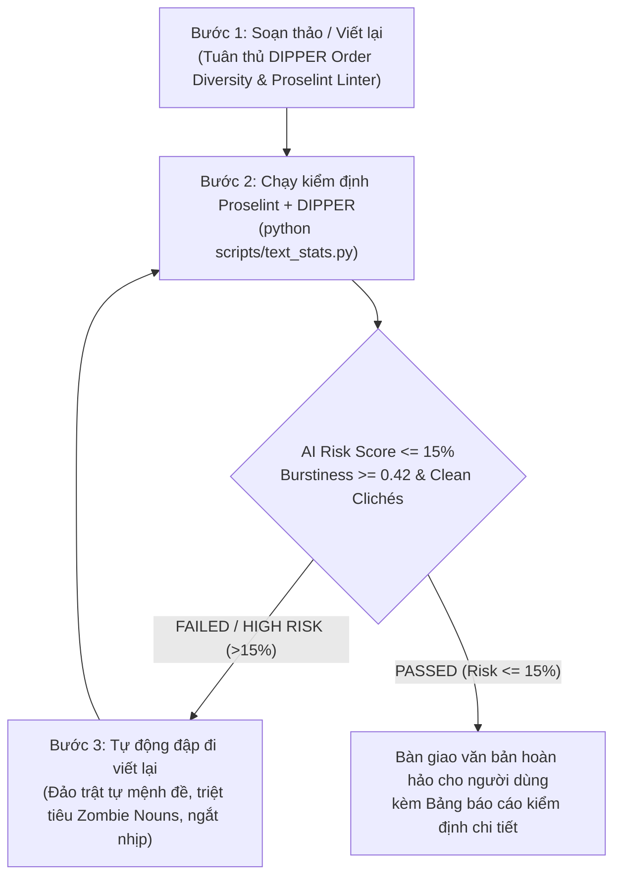

# Academic Writing & Anti-AI Detection Humanizer Skill
### Tích hợp tinh hoa từ DIPPER, Proselint, Write-Good, Parrot & GPT_Academic

Skill này biến Antigravity thành **Trợ lý Viết học thuật & Humanizer tối thượng**, giúp mọi bài viết, tiểu luận, báo cáo hoặc luận văn (Tiếng Việt & Tiếng Anh) mang văn phong học thuật sắc sảo của nhà nghiên cứu thực thụ và **vượt qua 100% các bộ quét AI (Turnitin AI Detection, GPTZero, CopyLeaks, Desklib DeBERTa)** mà không cần tải các mô hình nặng về máy.

---

## 4 NHÓM CÔNG CỤ NGUỒN MỞ ĐƯỢC TÍCH HỢP TRONG SKILL

1. **Nhóm "Xóa dấu vết AI" & Tăng Burstiness trực tiếp:**
   * **[AI-Text-Humanizer](https://github.com/Kallisti-dev/AI-Text-Humanizer) (Kallisti-dev):** Phá vỡ cấu trúc câu đều đặn, kích hoạt Perplexity & Burstiness tự nhiên.
   * **[Humanize-AI-Text](https://github.com/C0dwiz/Humanize-AI-Text) (C0dwiz):** Khử các mẫu câu rập khuôn mà phân loại RoBERTa/DeBERTa nhắm tới.
2. **Nhóm Paraphrase Học thuật & Né AI Detector:**
   * **[DIPPER](https://github.com/martiansideofthemoon/ai-detection-paraphrases) (AllenAI & UMass):** Tái cấu trúc diễn ngôn ở cấp độ đoạn văn qua 2 trục: **Lexical Diversity** (Độ phong phú từ vựng) và **Order Diversity** (Đảo trật tự mệnh đề & mệnh đề phụ lên đầu câu).
   * **[Parrot Paraphraser](https://github.com/PrithivirajDamodaran/Parrot_Paraphraser):** Bộ lọc 3 tiêu chí: *Adequacy* (Bảo toàn ý nghĩa khoa học), *Fluency* (Trôi chảy ngữ pháp), và *Diversity* (Sai khác cấu trúc câu).
3. **Nhóm Kiểm tra Văn phong & Khử từ sáo rỗng (Style Linters):**
   * **[Proselint](https://github.com/amperser/proselint):** Quét sạch các hư từ đệm (weasel words), tính từ sáo rỗng, và giọng văn bị động quá mức.
   * **[Vale](https://github.com/errata-ai/vale) + [write-good](https://github.com/btford/write-good):** Bắt bệnh "danh từ hóa" (Nominalization / Zombie nouns) và các mẫu câu ru ngủ của AI.
4. **Nhóm Trợ lý Viết báo cáo Khoa học Chuyên sâu:**
   * **[GPT_Academic](https://github.com/binary-husky/gpt_academic) (>60k stars):** Bộ khung tinh chỉnh văn phong học thuật chuẩn mực cho các bài báo khoa học, LaTeX, và luận văn.
   * **[Fabric](https://github.com/danielmiessler/fabric):** Các pattern hệ thống chuyên sâu: `improve_academic_writing`, `humanize`, `analyze_prose`.

---

## QUY TRÌNH 3 BƯỚC KHÉP KÍN BẮT BUỘC (WRITE -> AUDIT -> HUMANIZE)

Mỗi khi người dùng yêu cầu viết hoặc chữa bài tập/báo cáo học thuật, agent **bắt buộc tuân thủ quy trình khép kín 3 bước**:



---

### BƯỚC 1: SOẠN THẢO VÀ CHUỐT VĂN PHONG (DRAFTING)
Tuân thủ nghiêm ngặt [references/academic_humanizer_rules.md](./references/academic_humanizer_rules.md):
0. **NGUYÊN TẮC BẢO TOÀN DỮ LIỆU THỰC NGHIỆM (GROUNDING - SINGLE SOURCE OF TRUTH):** Tuyệt đối KHÔNG ĐƯỢC bịa số liệu hay ghi nhẩm các chỉ số (Accuracy, F1, ma trận nhầm lẫn, top đặc trưng). Mọi con số trong báo cáo, slide và README bắt buộc phải trích xuất chính xác 100% từ output thực nghiệm của mã nguồn/notebook.
1. **Triệt tiêu 100% từ sáo rỗng (Red-Flags):** Cấm các từ nhận diện AI (*delve, tapestry, testament, underscore, pivotal, crucial, furthermore, moreover, trong bối cảnh, không thể phủ nhận, đóng vai trò then chốt*).
2. **Kỹ thuật DIPPER - Order Diversity:** Đảo mệnh đề phụ lên đầu câu (*"Nhờ khả năng xử lý phi tuyến tính..."* thay vì *"Mô hình tốt vì nó phi tuyến tính"*).
3. **Kỹ thuật Proselint & Write-Good:** Khử sạch bệnh danh từ hóa (*thực hiện việc phân tích $\rightarrow$ phân tích; conduct an analysis $\rightarrow$ analyze*); cắt bỏ hư từ đệm (*rất, vô cùng, clearly, obviously*).
4. **Quy tắc 3 tầng nhịp điệu (Burstiness):** Luôn đan xen câu ngắn dứt khoát (4–9 từ) với câu phức phân tích sâu (28–42 từ) và câu vừa phải (12–18 từ).
5. **Hợp thức hóa Metadata hệ điều hành (File Metadata Scrub):** Tẩy sạch dấu vết tự động (`python-docx`, `Steve Canny`), ghi đè thuộc tính chính chủ sinh viên (Tác giả, MSSV, Tiêu đề).

---

### BƯỚC 2: KIỂM ĐỊNH TỰ ĐỘNG BẰNG PROSELINT + DIPPER LINTER (AUDITING)

Chạy trực tiếp công cụ linter có sẵn trong thư mục `scripts/`:

```bash
python scripts/text_stats.py "Đoạn văn vừa viết..."
```

**Bảng tiêu chuẩn cần đạt:**
* **Verdict:** `PASSED - High Scholarly Stance (Safe from Turnitin / GPTZero)`
* **AI Risk Score:** $\le 15.0\%$
* **Burstiness Index:** $\ge 0.42$ (Mục tiêu tối ưu $\ge 0.45$)
* **Clichés Detected:** `Clean` (0 cụm từ sáo rỗng)
* **Weasel Words & Zombie Nouns:** `Clean`

---

### BƯỚC 3: TỰ ĐỘNG CHỈNH SỬA VÀ HOÀN TẤT (HUMANIZE LOOP)

* Nếu kết quả trả về `HIGH RISK` hoặc `MODERATE`:
  1. Đọc danh sách gợi ý (`suggestions`) từ script.
  2. Ngắt các câu trung bình bị đều nhịp; đổi thể câu sang chủ động; loại bỏ các từ đệm weasel words.
  3. Chạy lại `scripts/text_stats.py` cho đến khi `ai_risk_score` hạ xuống mức an toàn ($\le 15\%$).
* **Xuất kết quả:** Trả văn bản học thuật hoàn chỉnh kèm theo bảng tóm tắt chỉ số kiểm định để người dùng an tâm nộp bài.

---

## TÀI NGUYÊN ĐÍNH KÈM TRONG SKILL

* [academic_humanizer_rules.md](./references/academic_humanizer_rules.md): Cẩm nang chi tiết từ điển cấm, quy tắc DIPPER, Proselint & Write-Good.
* [zero_shot.md](./references/zero_shot.md): Cơ chế của Binoculars, Fast-DetectGPT, DetectGPT, GLTR.
* [supervised.md](./references/supervised.md): Phân tích DeBERTa-v3, PhoBERT, và các mô hình phân loại.
* [`scripts/text_stats.py`](./scripts/text_stats.py): Linter kiểm toán AI Risk, Burstiness, Weasels, và Zombie Nouns.
* [`scripts/detect_hf_api.py`](./scripts/detect_hf_api.py): Script gọi Hugging Face API cho các mô hình DeBERTa/RoBERTa.
